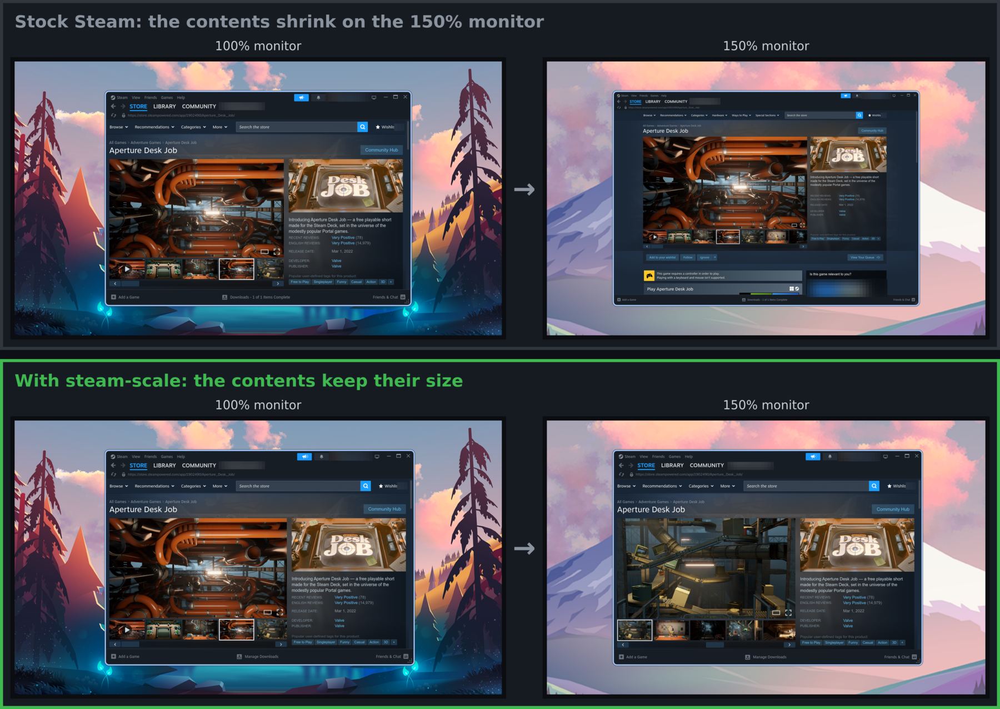

# steam-scale

Per-monitor fractional scaling for the Steam client on Wayland.

Steam runs under XWayland and draws every window at one scale. On a monitor that the compositor scales, for
example to 150%, Steam's text and buttons come out small. With steam-scale, each Steam window is drawn at the
scale of the monitor it is on. The window changes scale when you move it to another monitor and when a
monitor's scale changes. You configure nothing, because steam-scale reads the scales from the compositor.

The same window on a 150% monitor. Left: stock Steam. Right: Steam started through steam-scale. Both halves
are the same number of screen pixels.

One Steam session with steam-scale. Left: the window on a 100% monitor. Right: the window after a move to a
150% monitor.

## Requirements

- A Wayland compositor that supports the `xdg-output` protocol, version 2 or later.
- XWayland that runs unscaled, so that X11 applications see real pixels. On Hyprland, set
  `xwayland { force_zero_scaling = true }`. On KDE Plasma, select "Apply scaling themselves". Where the
  compositor scales XWayland, steam-scale changes nothing.

Development and testing happened on Hyprland. Other compositors are untested.

## Build and install

To build, you need a C compiler, make, pkg-config, wayland-scanner, wayland-protocols, and the development
files of libxcb (with RandR) and libwayland-client.

    make
    sudo make install            # into /usr/local

To install without root:

    make install PREFIX=$HOME/.local

For Arch Linux, `packaging/PKGBUILD` builds a package.

## Release

To release, change `pkgver` in `packaging/PKGBUILD` and push to `main`. The `Tag` workflow creates the tag
`v<pkgver>` and starts the `Release` workflow, which builds the Arch package and attaches it to a GitHub
Release.

## Start Steam

Start Steam the way you already do:

    steam

The install puts a `steam` link to `steam-scale` in the install directory. When that directory comes before
the real `steam` on `PATH`, as `/usr/local/bin` and `~/.local/bin` usually do, the name `steam` starts
steam-scale. steam-scale then starts the next `steam` on `PATH` and passes its arguments on.

A launcher that starts Steam by its full path, such as a desktop entry with `Exec=/usr/bin/steam`, does not
go through the link. Change that launcher to run `steam-scale`.

To install no link, run `make install SHADOWDIR=`. To put the link in another directory, run
`make install SHADOWDIR=/some/dir`.

Steam prints one `wrong ELF class` warning from `ld.so` at startup. Steam's first process is 32-bit and cannot
load the 64-bit library. The warning is harmless, because the process that draws the windows is 64-bit.

Games are not affected. The library removes itself from the environment before Steam starts a game.

## Environment variables

| Variable | Meaning |
|----------|---------|
| `STEAM_SCALE_STEAM` | Steam launcher to run. Default: the next `steam` on `PATH` |
| `STEAM_SCALE_MONITORS` | `X,Y,W,H=SCALE;...` in X11 pixels. Replaces detection |
| `STEAM_SCALE_LOG` | File to append a log to. Unset: no log |

## When it stops working

A Steam update can change the parts of Steam that steam-scale depends on. Steam then still starts, but its
windows return to one scale. [How steam-scale works](docs/internals.md) lists those parts, the symptom of each
change, and how to find which one changed.
